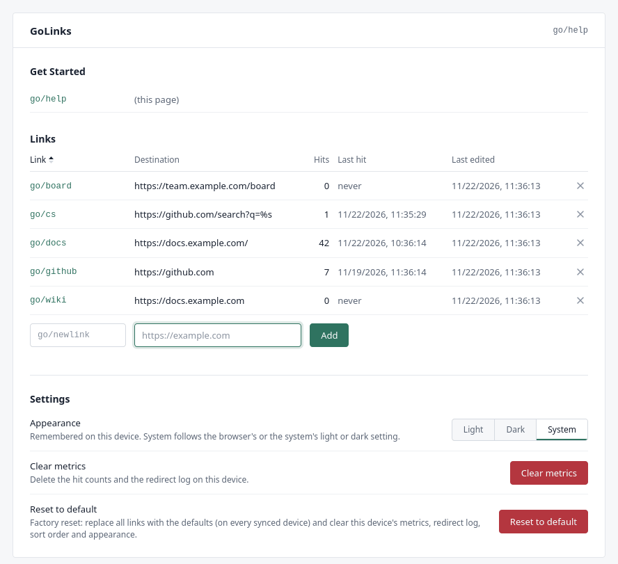
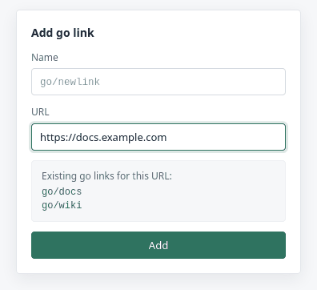
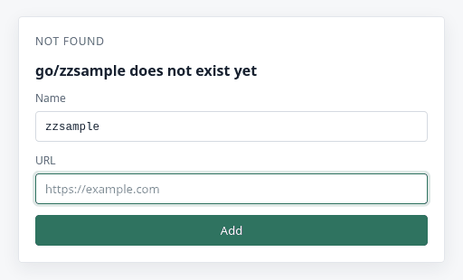

# GoLinks Browser Extensions

Browser extensions that provide in-browser go/ links (e.g., `go/github`) for quick navigation to configured URLs.

Add and manage your own links entirely offline, and sync them between your logged-in browsers. Available for both **Firefox** and **Chrome**.



## Features

- **Short links**: `go/<name>` redirects to the URL you saved (`go/github` → `https://github.com`).
- **Parameterized links**: a `%s` in the URL is replaced with whatever follows the name (`go/cs/example` → `https://github.com/search?q=example`).
- **Browser sync**: links and edits follow you across all logged-in devices using in-browser sync.
- **No dependencies**: uses native browser APIs only, no network calls. Works fully offline.
- **Usage statistics**: records hit counts on each device to track your usage. No data is shared.

## Getting Started

### Installation

Clone this repository, run `pnpm install` once (it installs only dev tooling: the formatter and the type checker; nothing ships in the extension), then build.

#### Firefox
1. `pnpm build:firefox`
2. Open `about:debugging` in Firefox
3. Click "This Firefox"
4. Click "Load Temporary Add-on"
5. Select the `manifest.json` file from the `dist/firefox` folder
6. Grant host permissions when prompted

Instead of those clicks, `pnpm load:firefox` builds and installs the add-on into your everyday Firefox; run it again after an edit to reload. It is a developer tool; CLAUDE.md describes what it does to the profile and the risks.

#### Chrome
1. `pnpm build:chrome`
2. Open `chrome://extensions/` in Chrome
3. Enable "Developer mode"
4. Click "Load unpacked" and select the `dist/chrome` folder

`pnpm build` builds both. Load `dist/`, never edit it.

### Usage

To access a go link, type `go/<name>` directly in the browser url bar (e.g. `go/github`). No scheme required.

A small set of links are included by default:
- `go/gh`, `go/github` → GitHub
- `go/cs/<query>` → Search GitHub for `<query>` ("cs" short for "code search")
- `go/gg` → Google
- `go/yt` → YouTube
- `go/mail`, `go/gmail` → Gmail
- `go/gcal` → Google Calendar

Default links can be edited or deleted just like any other link on `go/help`.

### Add new links

Add new custom links one of three ways:

- Open the destination url you want to link to, then use `Alt+Shift+G` or click the extension icon to open the new link window. Add your desired link name and save.
- Type the new `go/<name>` you want, then add the desired destination url on the not-found page.
- Open `go/help` and use the form at the bottom of the table.

Link names are case insensitive, and may use letters, numbers, `-`, and `_` (no spaces, or other special characters).

 

## Development

Needs Node 24 and pnpm.

```
pnpm test        # Biome check, type check, build and unit tests (about a second, no browser)
pnpm test:full   # also the headless Firefox and Chrome suites and the loader test
pnpm format      # Biome formatter; run before committing
pnpm screenshot  # saves PNGs of the pages to .screenshots/ (git-ignored)
```

The browser suites need snap Firefox with `geckodriver` and Google Chrome; see CLAUDE.md for the prerequisites and what they cover. CLAUDE.md is also where the storage layout, the metrics and redirect-log design and the cross-browser parity rules are written down.

### Technical Details

- **Chrome**: Manifest V3 service worker, `declarativeNetRequest` for the redirects; a bare `go/...` typed in the address bar works without any extra code
- **Firefox**: Manifest V3 event page, `declarativeNetRequest` for the redirects plus a `webRequest` listener that catches `go/...` typed in the address bar (Firefox turns it into a search)
- **Cross-browser**: shared code lives once in `common/`; only the manifests, the two `background.ts` files and Firefox's `search.ts` differ
- **Source**: TypeScript with no compiler: the build strips the types with Node's `stripTypeScriptTypes`, and only Node built-ins are used
- **Look**: one stylesheet, `common/theme.css`, for every page; `common/styleguide.html` lists its tokens and components
- **Permissions**: `declarativeNetRequestWithHostAccess`, `storage`, `activeTab`, `webRequest` (Firefox also `webRequestBlocking`). Everything stays in your browser.

### Architecture

```
golinks/
├── common/          # TypeScript, HTML and CSS shared by both browsers
├── chrome/          # Chrome-only manifest and background
├── firefox/         # Firefox-only manifest, background and address-bar search logic
├── types/           # type declarations for the type check (never built)
├── scripts/         # build, load-firefox and screenshot scripts
├── tests/           # unit, build, browser and loader tests
└── CLAUDE.md        # Detailed technical documentation
```
